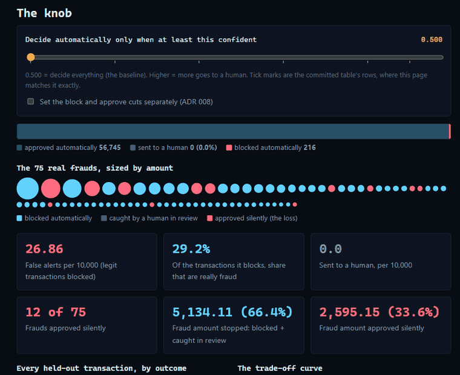
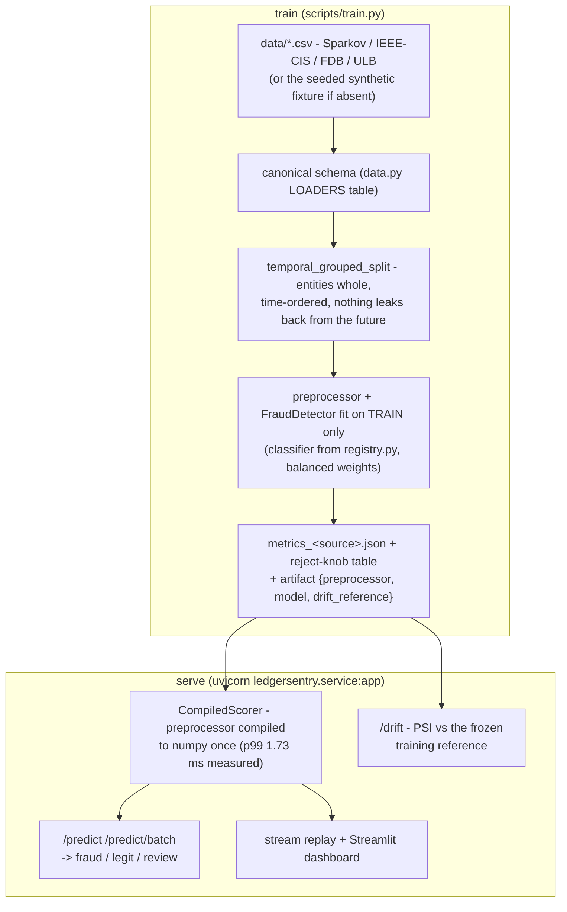

# LedgerSentry

[](https://github.com/Aeripsen/ledgersentry/actions/workflows/ci.yml)
[](https://aeripsen.github.io/ledgersentry/)

**[Live demo: drag the review knob over 56,961 real held-out card transactions](https://aeripsen.github.io/ledgersentry/)**

[](https://aeripsen.github.io/ledgersentry/)

**What this is, in 30 seconds.** A card-fraud model that is allowed to say "not sure, send
it to a person" instead of guessing. Tested on the last 7.65 hours of a public set of real
card transactions that it never saw in training, against the same model deciding everything
on its own at the default 0.5 cut:

- **Raising the auto-flag bar from 0.5 to 0.95 cuts false fraud alerts 96%**, from 26.9 to 1.1 per 10,000 transactions (95% CI 93% to 99%). That is the threshold's doing: the same bar with no review queue raises the identical 59 alerts.
- **The review band keeps what that bar would wave through:** alone, the 0.95 bar clears 22 of 75 frauds unseen. Sending the uncertain middle to review cuts that to 6, against 12 at 0.5 (paired 95% CI 2 to 11 fewer).
- **The price is stated:** 709 of every 10,000 transactions go to a human reviewer (7.1%), and 16 of those 4,039 are fraud. Whether reviewers catch them is not measured.

Every figure comes from `artifacts/business_case_ulb_creditcard.json` (`make business`,
details [here](docs/DETAILS.md#in-operations-terms-alerts-review-load-fraud-caught)). One fold and 75 frauds:
the intervals are wide, and they are a floor, because fraud comes in bursts. No model file is
committed; the scores come from the model the committed code retrains deterministically
(`make reproduce`). What CI checks about the live page is
[here](docs/DETAILS.md#the-live-demo-and-what-ci-checks).

Real-time financial-transaction fraud detection with a tunable reject-to-review option.
A gradient-boosted classifier that scores each transaction and, when it isn't confident
either way, abstains and returns `"review"` instead of guessing. It is the FlowSentry
architecture (my real-time network-intrusion-detection flagship) retargeted from network
flows to financial transactions: same reject-option idea, same leakage-safe evaluation
discipline, same honesty rules, different domain.

## The problem

Card fraud is rare (0.17% of this dataset) and adversarial, so a model forced to answer
fraud or legit for every transaction has to choose between two bad errors: false alerts that
block real customers, and fraud cleared with nobody looking. Real fraud desks have a third
answer, a human review queue, and their daily question is how much review capacity buys how
much accuracy. LedgerSentry scores each transaction, decides the confident ones on its own,
sends the uncertain middle to review, and measures that trade on held-out real data instead
of asserting it.

## Measured results, and the command that reproduces them

**PR-AUC 0.7278, 95% CI [0.6214, 0.8232]**, on 56,961 held-out real card transactions with 75
frauds, against a no-skill baseline of 0.0013. The same model at two settings of the knob:

| On the 56,961-transaction holdout | Cut at 0.5, no review | Review band at 0.95 |
|---|---|---|
| Auto-flags that are really fraud (precision) | 29.2% (63 of 216) | 89.8% (53 of 59) |
| Frauds auto-flagged (automatic recall) | 63 of 75 (84.0%) | 53 of 75 (70.7%) |
| Frauds sent to a human | 0 | 16 |
| Frauds surfaced (flagged or sent to review) | 63 of 75 (84%) | 69 of 75 (92%) |
| Frauds cleared with no human look | 12 | 6 |
| Traffic sent to review | 0 | 4,039 (7.1%) |

The 84% recall and the 89.8% precision belong to different columns; the table is there so
neither gets quoted without its price. Also measured and committed: Platt calibration cuts the
test-fold Brier score 4.2x without moving PR-AUC, and single-row scoring runs at p99 1.73 ms
against a 10 ms budget (`artifacts/benchmark_ulb_creditcard.json`, one Windows laptop).

```bash
pip install -r requirements.txt
python scripts/headline.py   # seconds, offline: recomputes every number above from the
                             # committed per-transaction scores; exits 1 if any differs
make reproduce               # retrains on the real data (one public file, see Data) and
                             # requires the metrics file back byte for byte
```

`headline.py` proves the numbers follow from the committed scores; it never trains.
`make reproduce` proves the scores follow from the code, and CI's `demo` job repeats it on the
sha256-checked public file.

## Why a temporal holdout

A shuffled split trains on transactions from after the ones it is graded on, so the model
learns this week's fraud and is tested on last week's, which inflates every metric and says
nothing about deployment. Here the model trains on the first ~40 hours and is tested only on
the final 7.65 hours, with the last training transaction one second before the first test one
(`split_boundary` in the business-case artifact), which is why this 0.73 is not comparable to
shuffled-split results and does not claim to be ([ADR 001](docs/adr/001-temporal-grouped-split.md)).

## The reject-to-review knob, explained

The model gives each transaction a fraud score p. One number, the review threshold t, turns
that into three outcomes: p at or above t is flagged as fraud, p at or below 1 - t is cleared,
and anything strictly between goes to a person as `"review"`. At t = 0.5 nothing is reviewed
and every call is automatic. Raising t does two separate things, and the measurements keep
them apart:

- **The higher bar makes the automatic flags precise.** Moving from 0.5 to 0.95 with no queue
  at all cuts false alerts 96% (26.9 to 1.1 per 10,000), but on its own it clears 22 of the
  75 frauds unseen.
- **The review band catches what the higher bar would wave through.** 16 of those 22 land in
  the queue instead, so only 6 are cleared unseen. The price is 709 reviews per 10,000
  transactions, and whether a reviewer catches those 16 is not measured.

`/predict` takes `review_threshold` per request, so the desk can move the knob without a
retrain; the dashboard and the [live demo](https://aeripsen.github.io/ledgersentry/) put it on
a slider. Why abstain at all: [ADR 003](docs/adr/003-reject-to-review-knob.md). Separate
flag and clear cuts are measured in [ADR 008](docs/adr/008-decoupled-reject-knob.md) and not
yet served.

## Summary lines, generated from the artifact

`make business` writes these into `resume_sentences`, and

`tests/test_demo_data.py` fails if this README stops quoting them word for word:

> Raising the auto-flag threshold from 0.5 to 0.95 cut false fraud alerts 96% (26.9 to 1.1 per 10,000 transactions, 95% CI 93% to 99%) on a temporal holdout of 56,961 real card transactions; a review band on the 0.05 to 0.95 middle routed to a human 16 of the 22 frauds that threshold alone auto-clears, at 709 reviews per 10,000.

> Split the 97.2% of fraud value that a single 0.05 threshold surfaces (95% CI 89.5% to 99.95%) into an 89.8%-precise auto-flag tier and a review tier of 7.1% of traffic; against the 0.5 default, frauds cleared without human review fell from 12 to 6 of 75 (paired bootstrap 95% CI 2 to 11 fewer).

## Architecture



Full picture with all three seams and the module map: [`docs/architecture.md`](docs/architecture.md).
The load-bearing decisions each have a short ADR in [`docs/adr/`](docs/adr): why this split
(001), why PR-AUC (002), why a reject option (003), what was deliberately NOT built (004),
the compiled scorer (005), calibration (006), the headline's confidence intervals (007),
decoupling the reject knob's two cuts (008), and comparing feature sets and boosting
configs without cheating the holdout (009).

## Quickstart

```bash
git clone https://github.com/Aeripsen/ledgersentry && cd ledgersentry
python -m venv .venv && source .venv/bin/activate   # Windows: .venv\Scripts\activate
pip install -r requirements.txt

pytest -q                       # the full suite, offline (MLflow tests skip without mlflow)
python scripts/headline.py      # the headline numbers, recomputed from committed scores
python scripts/train.py         # trains; with data/ empty it uses the synthetic fixture

uvicorn ledgersentry.service:app --app-dir src        # API on :8000
curl -X POST http://127.0.0.1:8000/predict -H "Content-Type: application/json" \
  -d '{"features": {"amount": 420.85, "category": "travel", "timestamp": "2026-03-04T02:11:00"}, "review_threshold": 0.9}'
streamlit run dashboard/app.py                         # the knob as a slider, on :8501
docker compose up --build                              # or both, as one stack
```

With no file in `data/`, training uses a seeded synthetic fixture so everything runs offline;
its numbers are labeled `is_synthetic: true` and never mixed with the ULB ones. Every other
script (calibration, bootstrap, cost, comparisons, SHAP, load test) is in the
[command reference](docs/DETAILS.md#command-reference).

## Limitations

- **One fold, 75 frauds.** The intervals are wide and cover sampling noise only; fold-choice
  variance is unmeasured until rolling-origin evaluation lands.
- **The dataset limits what can be learned.** ULB is two days of 2013 European card
  transactions with PCA-anonymized features and no card id, so the grouped split degrades to a
  purely temporal one, per-card velocity features cannot work (measured: they hurt), and SHAP
  names components, not reasons a person could act on.
- **Review outcomes are not measured.** Nothing here shows a reviewer finding the 16 frauds in
  a 4,039-item queue. The 0.95 operating point was read off the test-fold curve, so it is
  reported, not tuned on a validation slice.
- **Raw scores rank but are not probabilities.** Above 0.95 the knob sends almost everything
  to review. Platt calibration is measured; it is not yet shipped inside the served artifact.
- **The shipped model is not the best one measured.** LightGBM beat it on this fold (paired
  delta +0.0804 PR-AUC, 95% CI [0.0239, 0.1379]); the headline stays on the shipped model until
  that migration is its own change.
- **Serving is tested, not hosted.** Only the static demo is public. Container, Kubernetes and
  Terraform runs serve the synthetic-fixture model and test the serving path, not model
  quality. `/predict` returns no reason codes.
- **Two of the four loaders have no full run.** Sparkov and IEEE-CIS need Kaggle logins.

## Full write-up

Everything measured, how, and what it does not claim, is in [`docs/DETAILS.md`](docs/DETAILS.md):

- [The 90-second version](docs/DETAILS.md#the-90-second-version)
- [Why the usual approach on this dataset is wrong](docs/DETAILS.md#why-the-usual-approach-on-this-dataset-is-wrong) (accuracy, shuffled splits, forced binary answers)
- [Results on real data](docs/DETAILS.md#results-on-real-data-ulb-credit-card-fraud-measured-2026-07-15): the full knob table, bootstrap intervals, [in operations terms](docs/DETAILS.md#in-operations-terms-alerts-review-load-fraud-caught), the synthetic fixture, the booster head-to-head and SHAP
- [Measured latency and throughput](docs/DETAILS.md#measured-latency-and-throughput) and the [load test](docs/DETAILS.md#load-test-the-http-service-under-concurrent-clients)
- [Command reference](docs/DETAILS.md#command-reference) and [Serving + dashboard](docs/DETAILS.md#serving--dashboard)
- [Experiment tracking and drift reports (MLflow, Evidently)](docs/DETAILS.md#experiment-tracking-and-drift-reports-mlflow-evidently)
- [The live demo, and what CI checks](docs/DETAILS.md#the-live-demo-and-what-ci-checks)
- [Deploy](docs/DETAILS.md#deploy), with exact steps and captured output in [`DEPLOY.md`](DEPLOY.md)
- [Repository layout](docs/DETAILS.md#repository-layout) and [Roadmap](docs/DETAILS.md#roadmap)

Also: [model card](docs/model_card.md), [architecture](docs/architecture.md),
[threat model](docs/threat_model.md), [decision records](docs/adr), [changelog](CHANGELOG.md).

## Data

No dataset is committed to this repo. The headline uses the public ULB credit-card set
(284,807 transactions, 492 fraud), one download with no login:

```bash
curl -o data/creditcard.csv https://storage.googleapis.com/download.tensorflow.org/data/creditcard.csv
```

`data.py` also loads Sparkov, IEEE-CIS and Amazon's fraud-dataset-benchmark when their files
are dropped into `data/`; file names, sources and what each is for are in
[Data sources](docs/DETAILS.md#data-sources). All four loaders are tested in CI against tiny
true-schema fixtures, so a loader regression turns CI red without shipping any real data.

## Money boundary

This is fraud-**detection** software and research only. No trading, no moving money, no
personalized financial advice, anywhere in this repo.

## Attribution

- The reject-to-review knob is the same architecture as FlowSentry's two-stage reject
  option, from my accepted SECRYPT 2026 paper on hierarchical UDP/QUIC intrusion
  detection, retargeted here from network flows to financial transactions.
- Sparkov, IEEE-CIS, the Amazon `fraud-dataset-benchmark`, and the ULB credit-card set
  are public/synthetic datasets from their respective authors - see
  [Data sources](docs/DETAILS.md#data-sources). None are bundled in this repo.
- Built with scikit-learn, pandas, and joblib.

## Citing

[`CITATION.cff`](CITATION.cff) holds the citation; GitHub's "Cite this repository" button
reads it.

## License

MIT, see [LICENSE](LICENSE).
